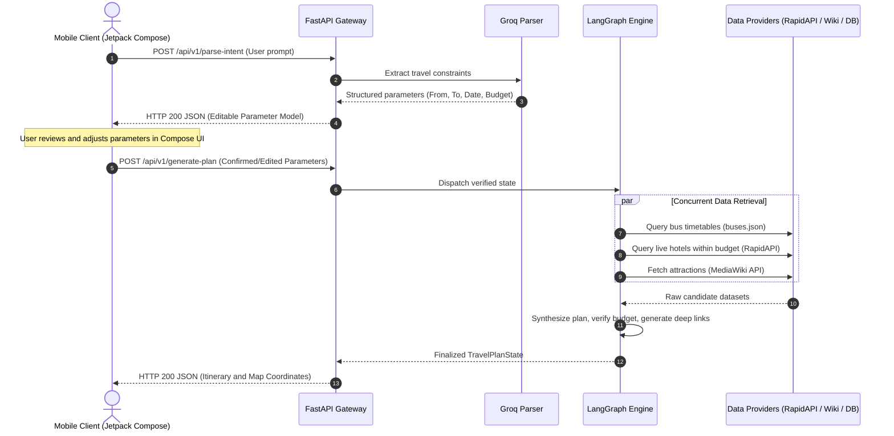

# AgenticTravelTech Backend

Backend service for AgenticTravelTech, built with FastAPI and LangGraph to process natural language travel queries, orchestrate parallel data retrieval, and produce budget-optimized travel itineraries.

---

## Directory Structure

```
AgenticTravelTech/
|-- app/
|   |-- main.py                     # Application entry point and lifespan
|   |-- config.py                   # Environment configuration
|   |-- database.py                 # Peewee database client (URL-based)
|   |-- dependencies.py             # Dependency injection providers
|   |-- models/
|   |   |-- base.py                 # Peewee BaseModel with DB binding
|   |   `-- travel.py               # TravelQuery and ItineraryRecord models
|   |-- routes/
|   |   |-- intent.py               # POST /api/v1/parse-intent
|   |   `-- planner.py              # POST /api/v1/generate-plan
|   |-- core/
|   |   |-- state.py                # LangGraph state schema (TravelPlanState)
|   |   `-- graph.py                # Workflow graph assembly and compilation
|   |-- nodes/
|   |   |-- intent_parser.py        # Groq NLP constraint extraction
|   |   |-- bus_search.py           # Timetable search and fare filtering
|   |   |-- hotel_search.py         # RapidAPI Booking.com inventory query
|   |   |-- tourist_places.py       # MediaWiki landmark extraction
|   |   `-- synthesizer.py          # Budget aggregation and deep-link generation
|   |-- schemas/
|   |   |-- request.py              # Pydantic request models
|   |   `-- response.py             # Pydantic response models
|   |-- services/
|   |   |-- groq_client.py          # Groq API client
|   |   |-- rapidapi_client.py      # Booking.com API client
|   |   |-- wiki_client.py          # Wikipedia API client
|   |   `-- bus_repository.py       # Local timetable data access
|   `-- utility/
|       |-- geo.py                  # Coordinate and distance helpers
|       `-- formatters.py           # Currency and timestamp helpers
|-- data/
|   `-- buses.json                      # Reference regional transit timetable
|-- docs/
|-- tests/                              # Integration test suite
|-- requirements.txt
`-- Dockerfile
```

---

## Execution Architecture


