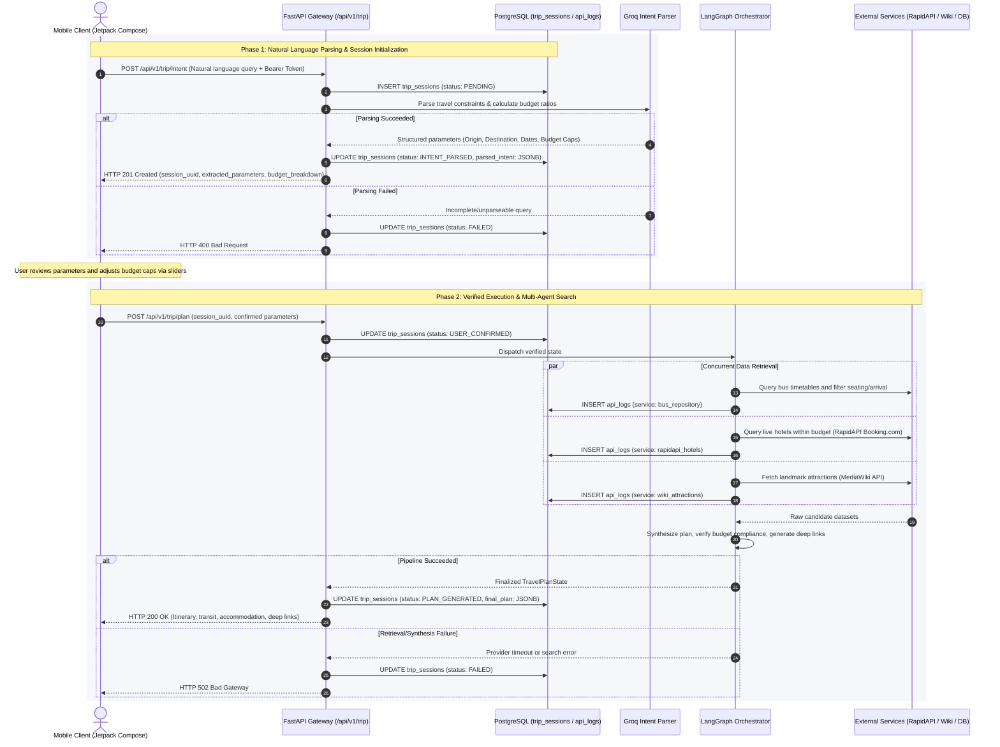

# Trip Planning API Specification

## Overview
The Trip Planning API implements a two-phase Human-in-the-Loop interaction model for agentic travel orchestration. 

1. **Phase 1 (Intent Parsing & Budget Breakdown):** Extracts constraints and parameters from natural language, calculates budget caps using standard allocation formulas, and creates a session.
2. **Phase 2 (Plan Confirmation & Agentic Execution):** Accepts validated or user-adjusted constraints, triggers the LangGraph agentic workflow (bus search, hotel search, tourist attractions, and synthesis), and persists the finalized itinerary.

All endpoints require authentication via Bearer JWT in the `Authorization` header.

---

## Execution Architecture & Session Flow



---

## 1. Parse Trip Intent (Phase 1)

Parses natural language travel queries, estimates budget allocations, and initializes a trip session.

- **Endpoint:** `POST /api/v1/trip/intent`
- **Authentication:** Bearer Token
- **Content-Type:** `application/json`

### Request Payload
```json
{
  "query": "Plan a budget weekend trip from Bangalore to Ooty for 2 people under 15000 INR starting next Friday, AC sleeper bus preferred, reach before 8 AM",
  "client_session_uuid": "550e8400-e29b-41d4-a716-446655440000"
}
```

| Field | Type | Required | Description |
| :--- | :--- | :--- | :--- |
| `query` | String | Yes | Raw natural language input from the user. |
| `client_session_uuid` | UUIDv4 String | Optional | Client-generated session identifier. Generated server-side if omitted. |

### Responses

**201 Created**
```json
{
  "session_uuid": "550e8400-e29b-41d4-a716-446655440000",
  "status": "INTENT_PARSED",
  "extracted_parameters": {
    "from_city": "Bangalore",
    "to_city": "Ooty",
    "travel_date": "2026-10-16",
    "passengers": 2,
    "bus_type": "AC Sleeper",
    "arrival_deadline": "08:00",
    "total_budget": 15000.0,
    "currency": "INR"
  },
  "budget_breakdown": {
    "transit_cap": 4500.0,
    "lodging_cap": 6000.0,
    "daily_reserve": 4500.0,
    "calculation_basis": {
      "transit_percentage": 30.0,
      "lodging_percentage": 40.0,
      "reserve_percentage": 30.0,
      "room_count": 1
    }
  },
  "created_at": "2026-10-10T17:23:00Z"
}
```

**400 Bad Request**
```json
{
  "detail": "Unable to extract origin or destination from input query."
}
```

**401 Unauthorized**
```json
{
  "detail": "Could not validate credentials."
}
```

---

## 2. Execute Plan Generation (Phase 2)

Receives confirmed constraints (modified by user via budget sliders or accepted as-is), locks parameters, and triggers the LangGraph agentic workflow.

- **Endpoint:** `POST /api/v1/trip/plan`
- **Authentication:** Bearer Token
- **Content-Type:** `application/json`

### Request Payload
```json
{
  "session_uuid": "550e8400-e29b-41d4-a716-446655440000",
  "from_city": "Bangalore",
  "to_city": "Ooty",
  "travel_date": "2026-10-16",
  "passengers": 2,
  "bus_type": "AC Sleeper",
  "arrival_deadline": "08:00",
  "transit_budget": 4500.0,
  "hotel_budget": 6000.0,
  "currency": "INR"
}
```

| Field | Type | Required | Description |
| :--- | :--- | :--- | :--- |
| `session_uuid` | UUIDv4 String | Yes | UUID of the session created in Phase 1. |
| `from_city` | String | Yes | Origin city name. |
| `to_city` | String | Yes | Destination city name. |
| `travel_date` | String (ISO 8601) | Yes | Departure date in `YYYY-MM-DD` format. |
| `passengers` | Integer | Yes | Total travelers count (minimum: 1). |
| `bus_type` | String | No | Seating tier filter (e.g., `AC Sleeper`, `Non-AC Seater`). |
| `arrival_deadline` | String (HH:MM) | No | Strict arrival time constraint in 24-hour format. |
| `transit_budget` | Float | Yes | Final user-confirmed maximum transit spend limit. |
| `hotel_budget` | Float | Yes | Final user-confirmed maximum lodging spend limit. |
| `currency` | String | No | Default: `INR`. |

### Responses

**200 OK**
```json
{
  "session_uuid": "550e8400-e29b-41d4-a716-446655440000",
  "status": "PLAN_GENERATED",
  "summary": {
    "total_estimated_cost": 9850.0,
    "allocated_budget": 10500.0,
    "budget_compliant": true,
    "savings": 650.0,
    "currency": "INR"
  },
  "transit": {
    "selected": {
      "operator": "KSRTC",
      "bus_type": "Airavat Club Class (AC Sleeper)",
      "departure_time": "22:30",
      "arrival_time": "06:15",
      "price_per_seat": 1950.0,
      "total_price": 3900.0,
      "booking_reference_url": "https://www.makemytrip.com/bus-tickets/..."
    },
    "alternatives": [
      {
        "operator": "GreenLine Travels",
        "bus_type": "AC Sleeper Multi-Axle",
        "departure_time": "23:00",
        "arrival_time": "06:45",
        "price_per_seat": 2100.0,
        "total_price": 4200.0,
        "booking_reference_url": "https://www.makemytrip.com/bus-tickets/..."
      }
    ]
  },
  "accommodation": {
    "selected": {
      "hotel_name": "Sterling Ooty Fern Hill",
      "star_rating": 4.0,
      "nights": 2,
      "rooms": 1,
      "price_per_night": 2800.0,
      "total_price": 5600.0,
      "booking_reference_url": "https://www.booking.com/hotel/..."
    },
    "alternatives": [
      {
        "hotel_name": "Hotel Lakeview Ooty",
        "star_rating": 3.0,
        "nights": 2,
        "rooms": 1,
        "price_per_night": 2200.0,
        "total_price": 4400.0,
        "booking_reference_url": "https://www.booking.com/hotel/..."
      }
    ]
  },
  "itinerary": [
    {
      "day": 1,
      "date": "2026-10-17",
      "activities": [
        {
          "name": "Ooty Botanical Gardens",
          "description": "Historical terraced botanical gardens established in 1848.",
          "recommended_duration_hours": 2.5
        },
        {
          "name": "Ooty Lake & Boathouse",
          "description": "Artificial lake constructed by John Sullivan in 1824.",
          "recommended_duration_hours": 2.0
        }
      ]
    },
    {
      "day": 2,
      "date": "2026-10-18",
      "activities": [
        {
          "name": "Doddabetta Peak",
          "description": "Highest peak in Nilgiri mountains offering panoramic views.",
          "recommended_duration_hours": 3.0
        }
      ]
    }
  ],
  "updated_at": "2026-10-10T17:23:45Z"
}
```

**404 Not Found**
```json
{
  "detail": "Session not found."
}
```

**409 Conflict**
```json
{
  "detail": "Session already finalized or in invalid state: PLAN_GENERATED."
}
```

**502 Bad Gateway**
```json
{
  "detail": "External provider failure during transit or lodging search."
}
```

---

## 3. Retrieve Session Details

Retrieves the current state and payload of an existing trip session.

- **Endpoint:** `GET /api/v1/trip/{session_uuid}`
- **Authentication:** Bearer Token

### Responses

**200 OK**
Returns session data including `status`, `parsed_intent`, and `final_plan` (if generated).

**404 Not Found**
```json
{
  "detail": "Session with specified UUID does not exist."
}
```

---

## 4. Retrieve User Trip History

Returns paginated list of previous trip sessions associated with the authenticated user.

- **Endpoint:** `GET /api/v1/trip/history?limit=10&offset=0`
- **Authentication:** Bearer Token

### Query Parameters
| Parameter | Type | Default | Description |
| :--- | :--- | :--- | :--- |
| `limit` | Integer | 10 | Maximum number of sessions to return (max: 50). |
| `offset` | Integer | 0 | Pagination offset. |

### Responses

**200 OK**
```json
{
  "total": 4,
  "limit": 10,
  "offset": 0,
  "items": [
    {
      "session_uuid": "550e8400-e29b-41d4-a716-446655440000",
      "from_city": "Bangalore",
      "to_city": "Ooty",
      "travel_date": "2026-10-16",
      "status": "PLAN_GENERATED",
      "total_cost": 9850.0,
      "currency": "INR",
      "created_at": "2026-10-10T17:23:00Z"
    }
  ]
}
```

---

## Error Handling Standards

All errors returned by the API conform to RFC 7807 standard error formatting:

```json
{
  "detail": "Human-readable explanation of the error",
  "error_code": "INVALID_STATE_TRANSITION"
}
```

### Standard Error Code Registry
| Error Code | HTTP Status | Trigger |
| :--- | :--- | :--- |
| `UNAUTHORIZED` | 401 | Missing, malformed, or expired JWT. |
| `SESSION_NOT_FOUND` | 404 | Unknown `session_uuid` or belonging to another user. |
| `INVALID_STATE` | 409 | Attempting to generate plan on an unparsed or already completed session. |
| `PROVIDER_TIMEOUT` | 504 | Upstream LLM or OTA provider exceeded timeout thresholds. |
| `INTERNAL_AGENT_ERROR` | 500 | LangGraph node execution failure. |
