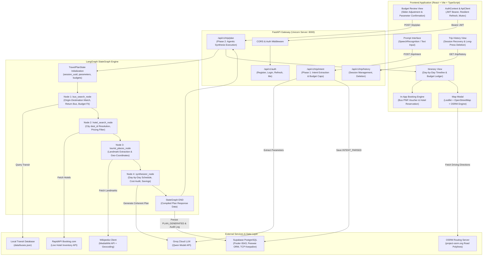
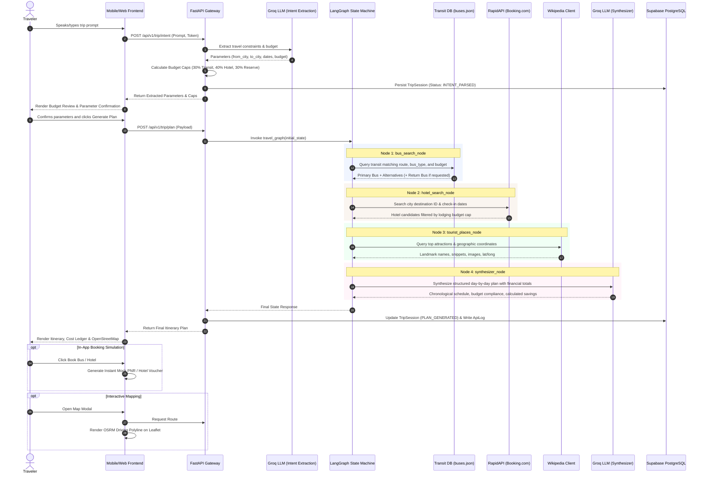

# Architecture and System Flow Diagrams

This document specifies the technical architecture, execution flows, and state machine transitions for the RoamAgent autonomous travel planning platform.

---

## 1. End-to-End System Architecture

---

## 2. End-to-End Execution Sequence

---

## 3. LangGraph State Machine Lifecycle

```mermaid
stateDiagram-v2
    [*] --> bus_search : Session State Initialized

    state bus_search {
        [*] --> FilterOutbound : Query Origin to Destination
        FilterOutbound --> CheckReturn : Transit Budget Checked
        CheckReturn --> SelectReturnBus : Return Required == true
        CheckReturn --> TransitFinalized : Return Required == false
        SelectReturnBus --> TransitFinalized : Combined Transit Cost Checked
        TransitFinalized --> [*]
    }

    bus_search --> hotel_search : Outbound + Return Bus Selected

    state hotel_search {
        [*] --> ResolveCityId : Destination Geocoding
        ResolveCityId --> QueryBookingApi : Date + Guest Parameters
        QueryBookingApi --> FilterPriceCap : Apply 40% Lodging Budget Cap
        FilterPriceCap --> SelectHotel : Primary + Alternative Selection
        SelectHotel --> [*]
    }

    hotel_search --> tourist_places : Hotel Selected

    state tourist_places {
        [*] --> QueryMediaWiki : Fetch Destination Attractions
        QueryMediaWiki --> ExtractCoordinates : Parse Geocoding Points
        ExtractCoordinates --> CompileLandmarks : Assemble Top Locations
        CompileLandmarks --> [*]
    }

    tourist_places --> synthesizer : Attractions Assembled

    state synthesizer {
        [*] --> ConstructPrompt : Merge Transit, Hotel, and Landmark Context
        ConstructPrompt --> InvokeGroqLLM : Structured Synthesis Request
        InvokeGroqLLM --> VerifyBudgetCompliance : Calculate Total vs Budget
        VerifyBudgetCompliance --> FinalStateCommitted : Append Ledger & Metrics
        FinalStateCommitted --> [*]
    }

    synthesizer --> [*] : Plan Ready (PLAN_GENERATED)
```

---

## 4. Architectural Boundaries and Component Responsibilities

### 4.1 Frontend Client (AgenticTravelTech_MobileApp)
- **Framework**: React 19, Vite, TypeScript.
- **State Management**: Context-based authentication with storage synchronization and auto-refresh locking.
- **Voice Pipeline**: Native browser SpeechRecognition API with automatic fallback to text input.
- **Map & Routing**: Leaflet integration consuming OpenStreetMap tiles and querying the OSRM routing engine for polyline driving geometries.
- **In-App Booking Engine**: Simulated PNR generator and lodging voucher confirmation modals avoiding third-party navigation redirects.

### 4.2 Backend Gateway (AgenticTravelTech)
- **Framework**: FastAPI with Uvicorn ASGI server.
- **Authentication**: JWT Bearer token security scheme (24-hour access token, 7-day refresh token).
- **Session Persistence**: Supabase PostgreSQL with Peewee ORM, connection pool keepalive (keepalives_idle=30, connect_timeout=10), and operational retry backoff.
- **Audit Logging**: Comprehensive ApiLog model capturing endpoint latency, HTTP status codes, and input/output payloads.

### 4.3 Multi-Agent State Machine (LangGraph)
- **State Schema**: `TravelPlanState` enforcing immutable key definitions across graph executions.
- **Bus Search Node**: Validates multi-passenger pricing, seat availability, arrival deadlines, and return journey constraints.
- **Hotel Search Node**: Resolves city codes against RapidAPI Booking.com, enforces a 40% lodging cap, and selects candidates based on star ratings and guest capacities.
- **Tourist Places Node**: Fetches verified landmarks, brief descriptions, and latitude/longitude coordinates via MediaWiki.
- **Synthesizer Node**: Invokes Groq Cloud Qwen model to generate day-by-day itineraries, calculate budget compliance, and format the final structured JSON response.
